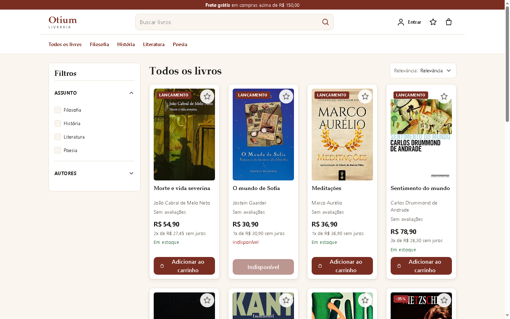
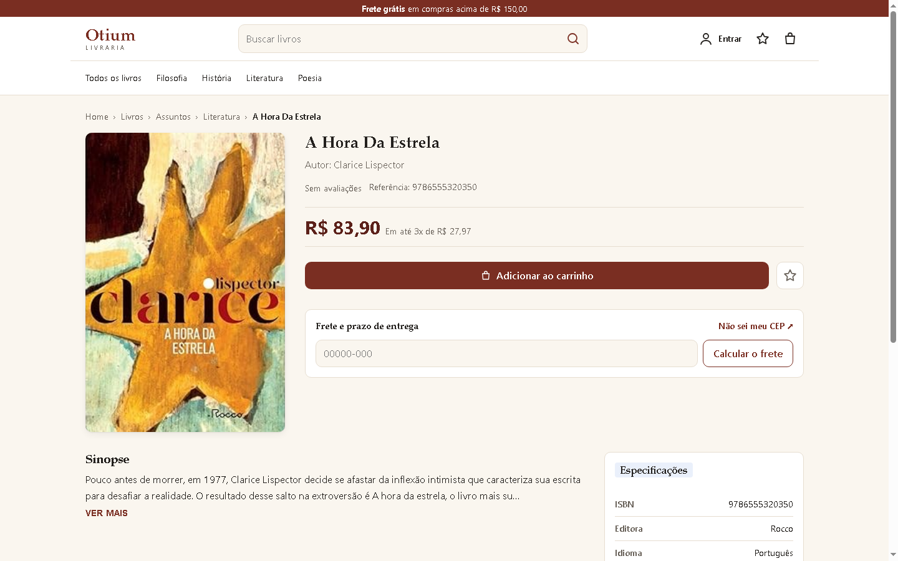
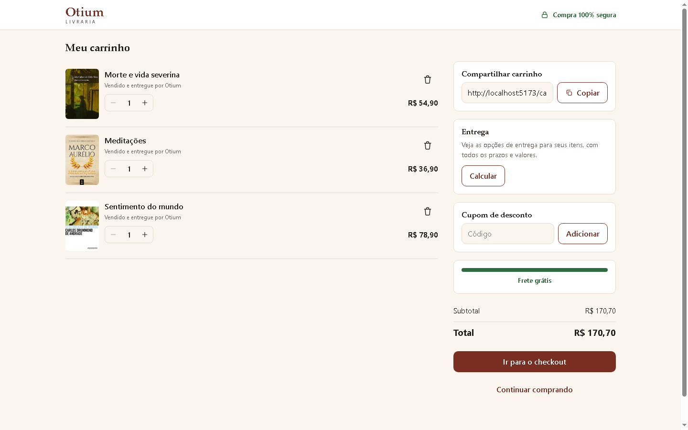
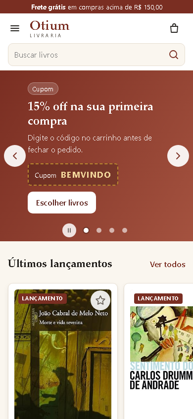
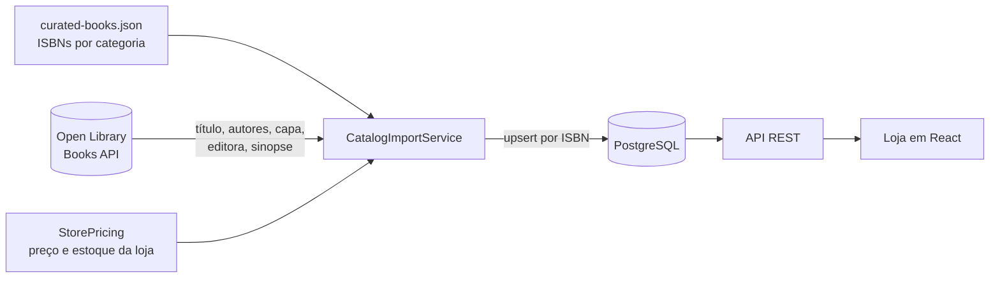

<div align="center">

# Livraria Otium


E-commerce fictício de livros, com API REST em Spring Boot e loja em React.
O catálogo usa livros reais, importados da API pública do [Open Library](https://openlibrary.org).

</div>


## Sobre o projeto

A Otium é uma livraria online feita como projeto de portfólio. A ideia é reproduzir o fluxo de uma loja de verdade:
vitrine, catálogo com filtros, página do livro, carrinho e checkout, com um backend que cuida de autenticação,
regras de catálogo e integração com um serviço externo.

Os livros não são inventados. A loja mantém uma lista curada de ISBNs de edições brasileiras e o backend busca no
Open Library os dados bibliográficos: título, autores, editora, número de páginas, ano, idioma, sinopse e capa.
O que é comercial (preço, desconto, estoque, lançamento) pertence à loja e é gerado pelo próprio backend.

## Telas

| Catálogo com filtros | Página do livro |
|---|---|
|  |  |

| Carrinho | Celular |
|---|---|
|  |  |

## Funcionalidades

- **Vitrine** com carrossel de promoções que troca a cada 5 segundos, com pausa e respeito a "reduzir movimento".
  As capas em cada banner são os livros que o link do banner abre.
- **Catálogo** com busca por título, filtros por assunto e autor, 8 ordenações (relevância, mais vendidos,
  desconto, preço, nome...) e paginação. Os filtros ficam na URL, então qualquer busca pode ser compartilhada.
- **Página do livro** com sinopse, especificações (ISBN, editora, idioma, páginas, ano) e parcelamento.
- **Carrinho** com controle de quantidade, cupons (`BEMVINDO` e `OTIUM10`) e barra de progresso para o frete grátis.
- **Checkout** com formulário de entrega e escolha de pagamento (cartão, Pix ou boleto).
- **Cadastro e login** com JWT; rotas de escrita do catálogo e de administração restritas a `ADMIN`.
- **Importação do catálogo** na subida da aplicação e sob demanda por um endpoint de administração.
- **Layout responsivo**, com filtros em gaveta e carrosséis horizontais no celular.

> Carrinho e favoritos ainda ficam em memória no front, e o checkout não gera pedido na API. Persistir carrinho,
> favoritos e pedidos pelo backend é o próximo passo do projeto.

## Tecnologias

**Backend** (`Back-End/`)

| | |
|---|---|
| Linguagem e framework | Java 25, Spring Boot 4.1 (Web MVC, Data JPA, Validation) |
| Segurança | Spring Security com JWT stateless (jjwt), senhas com BCrypt, CORS configurável |
| Banco de dados | PostgreSQL 17 com Hibernate; consultas dinâmicas com JPA Specifications |
| Integração externa | `RestClient` do Spring com timeouts, consumindo a Books API do Open Library |
| Documentação da API | springdoc-openapi (Swagger UI) |
| Testes | JUnit 6, Mockito, AssertJ, `MockRestServiceServer` |

**Frontend** (`Front-End/`)

| | |
|---|---|
| Base | React 19, TypeScript 5, Vite 6 |
| Rotas | React Router 7 |
| Estado | Context API (sessão, carrinho, avisos) e um hook próprio de requisições com cancelamento |
| Estilo | CSS puro com variáveis de design, sem framework de UI |

**Infraestrutura:** Docker Compose para o PostgreSQL de desenvolvimento.

## Como o catálogo é montado



- A loja depende da interface `BookMetadataProvider`, não do Open Library diretamente: trocar a fonte de dados
  não mexe nas regras do catálogo.
- As chamadas HTTP acontecem fora da transação do banco, para não segurar conexão esperando a rede.
- A importação é idempotente. Reimportar atualiza os dados bibliográficos e preserva preço e estoque, que são da loja.
- Preço, desconto e estoque são gerados com o ISBN como semente, então os valores são sempre os mesmos.
- Se o Open Library estiver fora do ar, a API sobe mesmo assim e a importação pode ser refeita depois
  (`POST /api/admin/catalog/import`, que responde 502 enquanto o serviço externo falhar).

## Como rodar

**Pré-requisitos:** JDK 25, Maven, Node.js 20+ e Docker.

```bash
# 1. Banco de dados (PostgreSQL na porta 5433)
docker compose up -d

# 2. API (http://localhost:8080) — na primeira subida importa os livros do Open Library
cd Back-End
mvn spring-boot:run

# 3. Loja (http://localhost:5173), em outro terminal
cd Front-End
npm install
npm run dev
```

- Documentação interativa da API: http://localhost:8080/swagger-ui.html
- Usuário administrador de desenvolvimento: `admin@otium.com` / `admin12345`
- Para recomeçar com o banco limpo: `docker compose down -v` e suba de novo.

## Testes

```bash
cd Back-End
mvn test
```

Os testes cobrem o cliente do Open Library (com respostas simuladas, sem rede), a normalização dos dados
(datas em texto livre, markdown nas sinopses), a importação idempotente, a geração de preços e a ligação
das configurações do Spring com o `application.yml` real.

## Estrutura

```
Back-End/
  src/main/java/com/otium/livraria/
    controller/     endpoints REST
    service/        regras de negócio e importação do catálogo
    integration/    fonte de dados externa (Open Library)
    entity/ repository/ dto/ mapper/
    security/       filtro e serviço JWT
  src/main/resources/catalog/curated-books.json
Front-End/
  src/
    pages/          telas (home, catálogo, livro, carrinho, checkout, login)
    components/     componentes reutilizáveis
    services/       chamadas à API
    contexts/       sessão, carrinho e avisos
docs/
  api.md            endpoints e regras de segurança
  modelagem.md      modelo do banco e decisões
```

## Créditos

Dados bibliográficos e capas: [Open Library](https://openlibrary.org), um projeto do Internet Archive.
Preços, estoque e promoções são fictícios.
